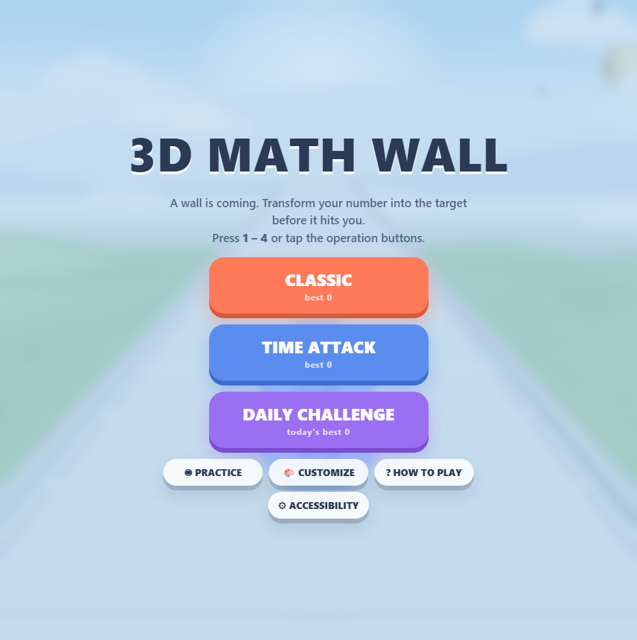
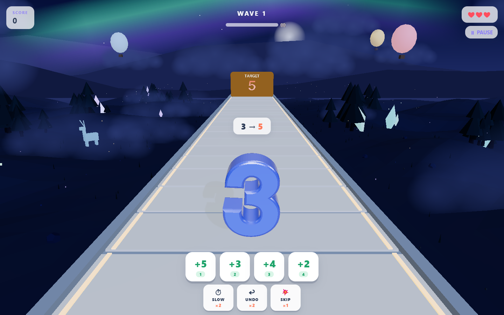
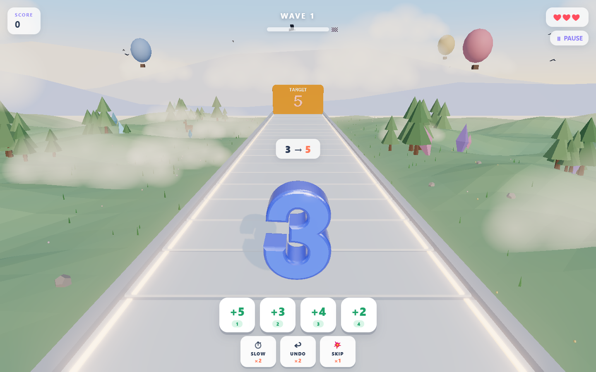
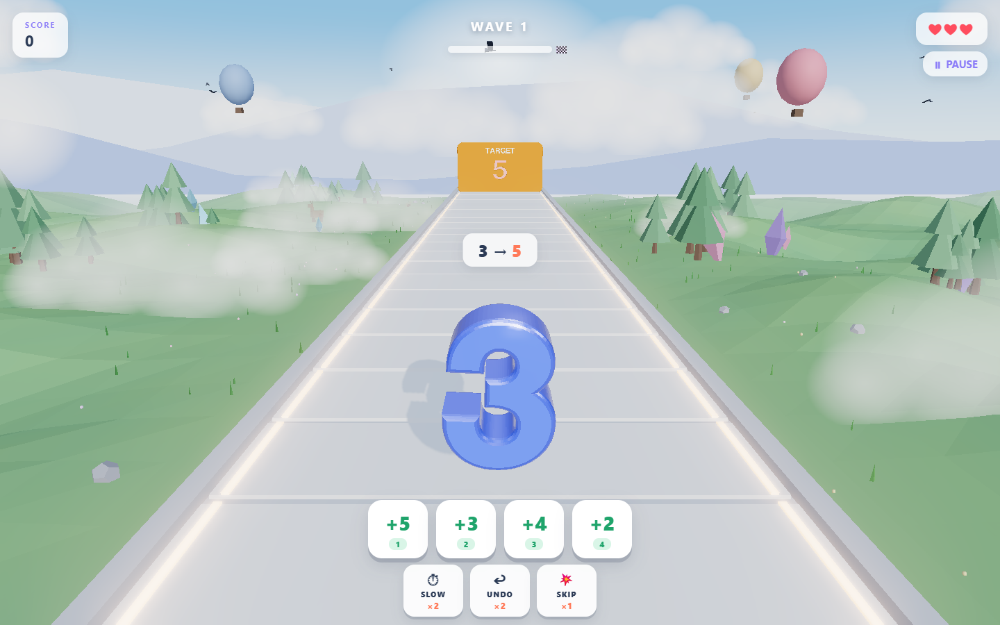
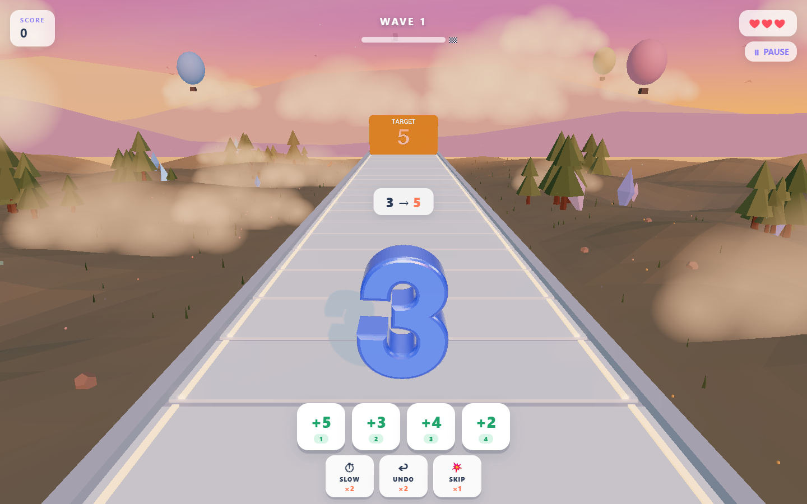
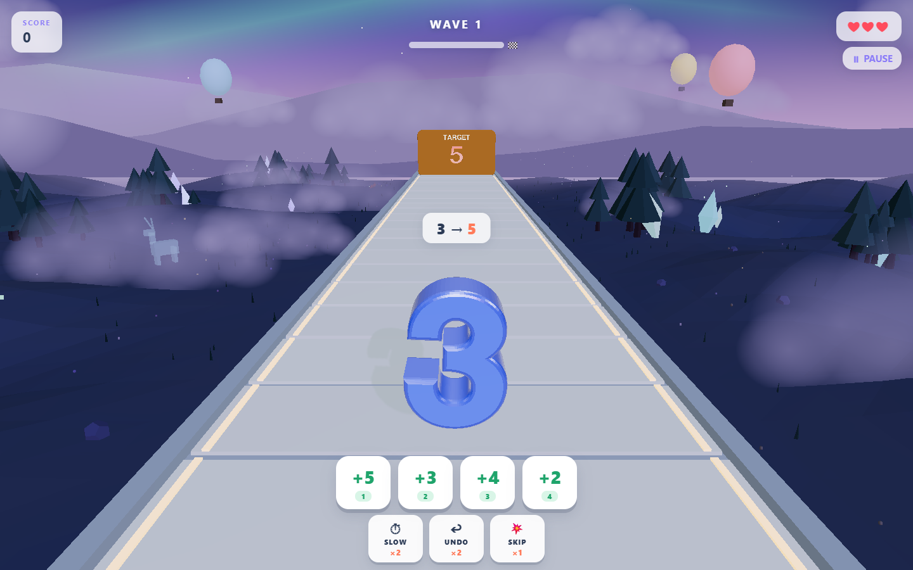

# 3D Math Wall

**Transform your number before the wall arrives.** A colorful 3D arithmetic action puzzle built with JavaScript and Three.js, playable directly in the browser.

[**Play the live demo →**](https://iceswift.github.io/3d-math-wall-game/) · [Technical walkthrough](docs/ARCHITECTURE.md) · [Gameplay rules](GAMEPLAY.md) · [Release notes](CHANGELOG.md)

[](https://github.com/iceswift/3d-math-wall-game/actions/workflows/ci.yml)
[](https://github.com/iceswift/3d-math-wall-game/actions/workflows/pages.yml)



## The idea

Your character is a number. Each approaching wall has a number-shaped opening: apply arithmetic operations to match its target before impact. Success rewards timing and planning; a mistake costs a heart or time. Boss walls require multi-step solutions.

This portfolio project combines procedural 3D geometry, a real-time game loop, deterministic puzzle generation, and browser-based UI and persistence. Maintained by [iceswift](https://github.com/iceswift), with its development history preserved in Git.

## Features

- **Classic:** endless waves, three hearts, harder puzzles and boss walls.
- **Time Attack:** a 60-second score challenge with crash penalties.
- **Daily Challenge:** a seeded 15-wall run based on the player's local calendar date.
- **Learn and practice:** interactive tutorial, selectable practice levels and hints.
- **Progression:** achievements, cosmetic unlocks and a number customization studio.
- **Presentation:** procedural day/night environment, bloom, particles, synthesized audio and animated result ranks.
- **Accessibility options:** reduced motion, reduced effects, high contrast and camera-shake controls.
- **Local saves:** best scores, customization and progression use localStorage.

## A world that changes with time

The environment cycles through **Morning → Day → Sunset → Twilight → Night** during play. Lighting, sky colors, fog and wildlife change with it. At night, glowing crystals, fireflies and aurora ribbons bring the landscape to life.

### Night — aurora and glowing wildlife



| Morning — warm light and meadow wildlife | Day — bright skies and green hills |
| --- | --- |
|  |  |

| Sunset — pink skies and warm fog | Twilight — violet hills and emerging stars |
| --- | --- |
|  |  |

Screenshots captured from the running game. Open an image to view it at full resolution.

## Controls

| Input | Action |
| --- | --- |
| `1`–`4` or tap an operation button | Transform your number |
| `Q` | Slow the world |
| `W` | Undo an operation |
| `E` | Skip a wall |
| `Esc` / `P` | Pause or resume |

Power-ups have limited charges. Match just before impact for a Perfect bonus.

## Technology

| Area | Implementation |
| --- | --- |
| Rendering | Three.js r160, WebGL, extruded glyph geometry, postprocessing |
| Application | JavaScript ES modules, HTML and CSS; no build step |
| Audio | Web Audio synthesis |
| Persistence | Browser localStorage; no account or backend |
| Verification | Node.js test runner and JavaScript syntax checks |
| Delivery | GitHub Actions and GitHub Pages |

Runtime libraries and the font are vendored in `lib/`; no external CDNs are needed.

## Run locally

Serve the repository directory with Python 3:

```sh
python -m http.server 5173 --bind 127.0.0.1
```

Open **http://127.0.0.1:5173/** in a browser with WebGL support. Use HTTP rather than opening `index.html` directly, so modules and fonts can load.

Run the development checks with Node.js 22 or newer:

```sh
npm run check
npm test
```

No `npm install` is needed. Tests cover 4,000 generated puzzles across 20 waves, seed reproducibility and invalid arithmetic operations. See [release validation](docs/VALIDATION.md) for browser checks and coverage limits.

## Engineering notes

- **Matching geometry:** player and wall openings share glyph layout calculations, keeping digit spacing aligned.
- **Solvable puzzles:** construct a valid operation chain before adding distractors. Tests replay solutions through the validity rules.
- **Repeatable daily runs:** a date-derived seed drives generation. Dates follow local timezones, and crashes can change subsequent puzzle paths.
- **Resource lifecycle:** obsolete walls dispose their geometries and materials.

See [architecture and tradeoffs](docs/ARCHITECTURE.md) for module responsibilities and limitations.

## Roadmap

- Broader touch-device and browser testing.
- Profile rendering performance on lower-powered devices.
- Gradually extract UI and scene responsibilities from `main.js`.
- Consider online leaderboards after designing a backend and score validation.

## Credits and usage

Three.js and the Helvetiker font retain their respective notices; see [third-party credits](THIRD_PARTY_NOTICES.md). No project-wide open-source license has been selected for the original game code or artwork. Public source visibility does not itself grant a reuse license.
