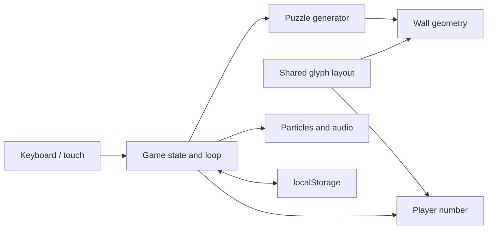

# Architecture and engineering decisions

## Runtime flow

`index.html` supplies UI panels and an import map pointing `three` to the vendored module. `main.js` initializes the scene, loads the font, wires controls and advances the game through an animation loop. Everything runs in the browser, with no backend or build step.

| File | Responsibility |
| --- | --- |
| `main.js` | Scene, environment, game state, progression, UI and loop |
| `js/puzzle.js` | Arithmetic validity, wave pools, seeded RNG and puzzles |
| `js/text3d.js` | Font loading, glyph layout and player geometry |
| `js/wall.js` | Extruded slabs, digit cutouts, match glow and disposal |
| `js/fx.js` | Particle bursts and wall debris |
| `js/audio.js` | Synthesized effects and audio activation |
| `index.html` | UI markup, styles and module entry point |

## Challenges and solutions

### Align the number and its hole

Scaling an entire multi-digit silhouette changes digit spacing. Player and wall instead share per-digit glyph layout. Each hole receives a margin around its own center, while counters inside digits such as 0 and 8 are handled separately.

### Generate solvable puzzles

The generator chooses valid operations from the current value, computes the target, then mixes the solution buttons with distractors. Bosses require two steps, increasing to three at wave eight. Validity checks exclude fractional division, negative results and values above the intermediate bound. Final targets stay between 1 and 999.

Tests replay 4,000 generated puzzles over deterministic seeds and waves, checking reachable targets, valid intermediate values and boss solution lengths. This is sampled coverage, not a proof of all RNG states.

### Keep upcoming walls consistent

Upcoming walls assume the player reaches the previous target. A crash or skip invalidates that assumption, so the queue is rebuilt from the actual value. Old walls are removed and their GPU resources disposed.

### Repeat daily challenges without a server

A date string seeds a deterministic RNG. Equal seeds and gameplay paths reproduce the sequence. Dates use local timezones. Scores are editable browser storage, so they cannot support a trusted global leaderboard without additional infrastructure.

## Tradeoffs and limitations

- Vendored dependencies keep runtime self-contained; upgrades and license notices require explicit maintenance.
- The large `main.js` supports quick iteration but complicates maintenance. Extracting UI, progression and environment modules is future work.
- Rendering requires WebGL. Reduced-effects settings help; broad device performance has not been benchmarked.
- Accessibility options exist; full assistive-technology conformance has not been audited.
- `assets/sky/` holds unused legacy images with undocumented provenance. They are excluded from the deployed demo.

## Delivery

`Checks` runs syntax checks and Node tests on pushes and pull requests. `Deploy demo` repeats checks on `main`, stages runtime files and required notices, then publishes to GitHub Pages. Documentation, legacy images and development files are excluded from the deployment artifact.
